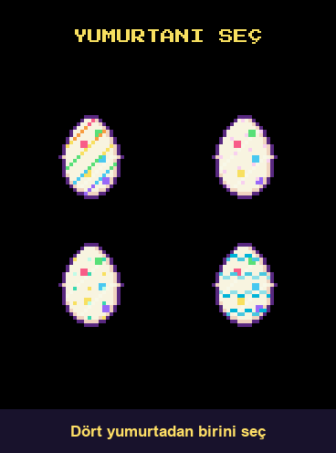
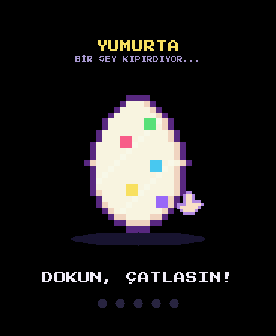
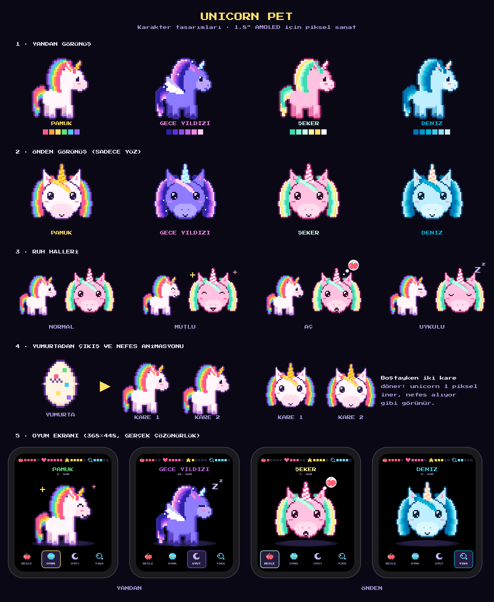
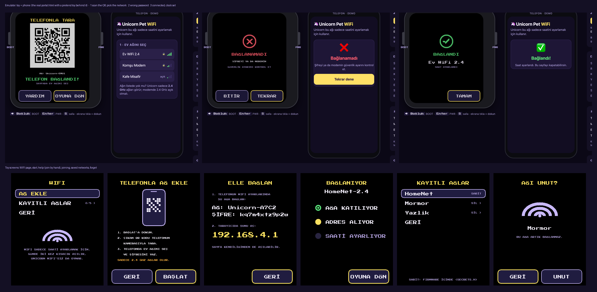

# Unicorn Pet

A Tamagotchi-style pixel-art unicorn for the **Waveshare ESP32-S3-Touch-AMOLED-1.8**
(368×448 AMOLED, touch, speaker, IMU, battery in the case).

One game core runs in three places: the firmware, a browser emulator (WebAssembly) and host
tests, so what you play in the browser is what runs on the board.

**Every feature in one captioned tour** (2 min 20 s, recorded from the real core with
`make -C test tour`):







```
tools/   Python asset generator (pixel art) -> core/assets.gen.h
core/    rules (game.cpp), renderer (render.cpp), melodies (sound.cpp)
         freestanding C++: no libc, no heap, no STL
emu/     browser emulator: the core compiled to wasm + index.html
fw/      PlatformIO firmware: display, touch, buttons, IMU, audio, NVS, light sleep
test/    host tests (ASan/UBSan) + the same events through the wasm build
design/  character, pose and screen sheets
```

## Play it in the browser

```sh
emu/run.sh                 # builds emu/unicorn.wasm, serves http://localhost:8732/emu/
```

- Click the screen = touch. `→` / `Space` = BOOT (next), `Enter` = PWR (select), `S` = shake.
- Side panel: time speed (1×–600×), sliders to make her hungry/tired/dirty, shake, power cut,
  new egg. On a phone, a real shake works too.
- Sound plays the same melodies as the board (Web Audio, square wave).
- Progress is kept in `localStorage`, like NVS on the board.

Needs Homebrew `llvm` and `lld` (`brew install llvm lld`); no emscripten.

## The game

| Event | What happens |
|---|---|
| Egg pick | four eggs (one per character) wobble in a nest; tap one to lift it, tap it again or the heart to keep it. The choice is saved, and an old save keeps its unicorn |
| Egg | every tap wobbles it and a crack spreads; after five taps (or shakes), or one minute, the shell splits, confetti flies and her face grows in |
| Besle (feed) | apple, strawberry and carrot in turn, eaten from a bowl bite by bite with flying crumbs: hunger +35%, happiness +3% |
| Oyna (play) | a toy box with four pictures and a house: stars, the music garden, the cloud and the mirror. Every mode has the house button and ends by itself (time's up, or 12 s with nobody playing) |
| Music garden | three singing flowers (C, E, G). Tap up to six; after a short pause she sings your tune back as one melody, with notes floating up |
| Cloud | tilt the toy (or the emulator's slider / a phone) to steer her cloud under six falling feathers for 15 s; touching the left/right third works too |
| Mirror | try on a bow, flower or tiara; it follows her head through every pose and is saved |
| Stars, or shake the toy | **Yıldız yakala**: 15 s of popping big rising stars (touch, PWR on the selected star, or a shake), then she jumps after a ball and the stars are counted. Happiness +30% whatever the score (stars are for fun, not a grade); energy −10%, a bit hungrier and dirtier; refuses below 15% energy |
| Uyut (sleep) | lies down, the screen turns to night colours and a folded patchwork quilt waits: the first touch (or shake, or PWR) pulls it over her up to her chin, otherwise she tucks herself in after 4 s. While anyone is looking she dreams, a little animated cloud every 8 s: the first dream is something she did that day (her snack, bath bubbles, stars, songs, the cloud ride, her bow or tiara, hearts, the butterfly), the others anything from 14 dreams (a rainbow, a friend, the ball, the moon, the egg she came from, her garden...), never the same twice in a night. Energy refills in ~2 h; she wakes by herself, or on the next touch or shake |
| Yıka (wash) | bubbles rise, the rainbow messes on the floor dissolve, a sparkle at the end: clean 100%, happiness +3%. Three foam puffs can be popped by touch; pop all three for a bubble crown (the wash ends the same either way) |
| Butterfly | now and then a butterfly visits the home screen and lands on her; purely to look at, no sound, gone when the screen sleeps |
| Tap the unicorn | petting: hearts float up and she beams; happiness +2% at most every 2 s |
| Tap the name/status bar | front-face info screen with all needs, and the sound on/off switch |

### Her day, and the days you spent together

None of this asks anything of the child, and nothing is lost by missing it.

- **Day and night:** the home screens show a sun and a cloud by day (07:00-17:00), a low orange
  sun in the evening (17:00-20:00) and the stars and moon at night. The colours never send her to
  bed and never change her needs.
- **Hello again:** after a real break (15 minutes with the screen dark) or on power-up she greets
  you for 2 s, with a stretch by day, a smile in the evening or a yawn at night, plus a speech
  bubble with a heart and the snack you last gave her. It does not use up screen time and makes no
  sound.
- **Memory album:** the first care of each new day (feeding, washing, petting or bedtime) adds a
  picture. It floats up to her name, and the book on the info screen (tap the name) bounces until
  you look. Each book holds 12 days, and a new one starts after that. Old books stay full and can
  be paged through with the arrows (or BOOT). Empty spots are blank paper, not locked shapes.
  There are no streaks: a skipped week just means the next picture.
- **Her garden:** every book has three pots that grow from seed to bloom over that book's days
  (pot 1 on days 1-4, pot 2 on 5-8, pot 3 on 9-12) and never wilt. Every three books the garden
  changes: flowers, then heart flowers, then autumn leaves, then stars.

### She never dies, so she grows up

Her life is counted in **days together**: distinct days on which she was cared for (the home
screen shows "BİRLİKTE N. GÜN"). Powered hours no longer count, so switching the toy off at
night costs nothing.

- **Growing up:** she is a foal at first (drawn a size smaller, x4 instead of x6), young from day 7,
  grown from day 30 and a "storykeeper" from day 100. Grown-ups get a sparkle on the flank (three
  for a storykeeper), and her portrait on the info screen gets stars. Stages only ever add; neglect never takes them away,
  and every toy is open from day one.
- **Milestones:** days 7, 30, 100 and 365 each get one 3 s celebration ("BÜYÜDÜM!", "1 YIL!"). If
  several are crossed at once, there is one party for the biggest.
- **Birthday:** the day she hatched is her birthday (an older unicorn adopts the first day the
  clock knows). On the first visit on or after the anniversary there is a 4 s party with a cake
  and a candle for each year (up to five). After a long absence there is one party, never a
  backlog. A 29 February birthday is celebrated on the 28th in other years.
- **Long gaps:** after a week or more without care she greets you with "ÖZLEDİM!" and her needs
  are topped up to 80%: a welcome, never a reproach.
- **Left alone:** while the screen is dark her needs never drop below 15%. She is peckish in the
  morning (a gentle reason to feed her), never miserable.
- Only one celebration shows at a time, never on the door while she is away, and each is marked
  done as it starts, so a reboot does not repeat it.

- **Tricks she learns:** ten of them, one after another over the days together: humming (day 3,
  notes float up, no sound), a bow (5), a twirl (7), a dance (14), a rainbow arching behind her
  (21), blowing bubbles (30), tossing a star and catching it (45), a ball bouncing on her nose (60),
  magic sparkles round her horn (100) and a grand show (200). A trick she has just learned is shown
  off first, with a burst of stars; after that they take turns. At most one every 12 s, every
  second lively idle moment; never when she needs something, never at bedtime, never while the
  butterfly visits. Calm mode leaves out the hopping and spinning ones. What she has learned comes
  from the days together in the save, so a power cut or a new firmware does not take it away.
- **Bedtime:** the parent sets a bedtime and a wake-up time (settings > **UYKU**, default 19:30 to
  07:00, 10-minute steps, can be switched off). At bedtime, if she is still up, she gets drowsy:
  heavy eyes, swaying on her feet, and the moon button bounces. An hour later, still up, she falls
  asleep standing. Asleep in that window, whether put to bed or not, she cannot be woken (a touch
  just gets a sleepy murmur, being rested does not count) until the wake-up time, when she gets up
  with a stretch. If her time is up at bedtime she goes to sleep instead of out with friends.
  Switched on in the middle of the night, she is found asleep lying down. It needs a trusted clock:
  without one the rule waits (and a clock that stops being trusted lets her be woken).

The day comes from the wall clock. On the board the RTC keeps UTC, and the firmware turns it into
local time with the time zone's rules, so summer time switches by itself, even offline. With WiFi
(see "WiFi and location" below) the clock sets itself about twice a day. Without it, the RTC is
set from the firmware's build time on the first boot after flashing. If the battery runs completely flat the
clock restarts at that build time: breaks still work, but the date is a guess, so the day and
evening skies, the album and the garden pause until a parent sets the clock (settings > **SAAT**)
or the firmware is flashed again.
In the emulator, the **Saat** field sets the clock, and the speed buttons move the clock too, so days
(and album pictures) pass in minutes.

### Battery and charging

- **Battery indicator:** top right on the home screens and the info screen: four bars that turn
  from green to yellow to red, a yellow bolt while the cable is in, and a blinking red outline
  below 10% when unplugged. Hidden while the level is unknown.
- **Plugged in:** at home she lies down on a striped sun lounger. By day and in the evening she
  sunbathes with sunglasses on ("GÜNEŞLENİYOR · ŞARJ OLUYOR"), at night she rests with a pink
  sleep mask, and if she is tired at night she goes to bed properly (the quilt and dreams). The
  sun charges her as well: on the lounger her energy refills like in sleep, and her other needs
  slow down. Touch her and she waves hearts; the menu and the header work as at home. Unplugging
  brings her back up with a stretch. While the cable stays in she returns to the lounger after
  10 s at home with nothing going on.
- **What the cable never does:** wake her from sleep, light the screen at night, knock on the
  door while she is out, or touch the egg or the settings. Plugging in counts only after two
  matching readings (a loose connector), booting on the charger is not a "plug-in", and a re-plug
  within 5 s makes no sound.

The board reads USB power (AXP2101 `isVbusIn()`, not `isCharging()`, which stops at 100%) every
second and the battery level every 30 s. The emulator has a battery slider and a "şarjda" box
(they follow the computer's own battery until you move them).

### Screen time: she has things to do

After **10 minutes** of screen-on play she finishes what she is doing, says "İŞİM VAR!" and walks
off to play with her friends. A door with a **RAHATSIZ ETMEYİN** sign stays behind for
**30 minutes**: the screen goes dark after 5 s, knocking only rattles the sign (it does not keep
the screen on), six stars fill up so the child can see when she is coming back, and her needs are
frozen while she is out. The next touch after the break brings her back ("GELDİM!"). A 15-minute
break with the screen dark resets the counter. The state is saved the moment she leaves, so
pulling the power is no shortcut. The break is timed by the board's **PCF85063 RTC** when it keeps
running while the board is off, so a break that passed overnight is over in the morning; if there
is no trustworthy clock (it lost power and restarted, or went backwards) the game falls back to
counting powered time from what was left. Only the break uses the wall clock: needs still freeze
while the board is off. The emulator has an RTC checkbox and a "10 DK DOLDU" test button. Grown-ups can call her back early with the grown-up gesture (below) on
the door (the emulator has a button for it). Limits are `PLAY_LIMIT_MS` / `AWAY_MS` in
`core/unicorn.h`.

### Smooth animation

The simulation runs in fixed 100 ms steps (so every test is deterministic), and the renderer
interpolates between steps: positions, a sine-wave breathing bob, parabolic hops and jumps, a
damped egg wobble, rising Zz, a 4-frame walk cycle. While anything moves the core asks for a fresh
frame on every call; the firmware caps pushes at ~30 fps, the emulator draws at the browser's rate.

When nobody is playing she lives on her own: blinks, wanders left and right (mirrored), hops when
she is happy. A hungry, tired or sad unicorn stays put. Low cleanliness leaves little rainbow messes
on the floor. Needs drain over ~8–17 h of powered time. She never dies: low needs only change her face.

The screen goes dark after 20 s; the first touch only wakes it. Tunables are the enum at the top
of `core/unicorn.h`.

### Made for pre-readers, and for their parents

- **Wordless hints:** a little hand taps the egg, then shows how to pet her; the button for what she
  needs gently bounces (Besle when hungry, Uyut when tired, ...); a hand points at the snacks if
  nobody chooses.
- **She chooses with you:** Besle opens three big snacks (apple, strawberry, carrot) to tap.
- **Kind when tired:** "too tired to play" shows a big pillow button that puts her to sleep, and a
  one-minute nap is already enough to play again.
- **No pressure:** the star game's score no longer changes her happiness (it is just counted);
  the door shows friends playing instead of a countdown, and knocking does nothing.
- **A warm goodbye:** a friend arrives ("HADİ!"), they hug, and walk off together.
- **Game feel:** buttons dip and pop, she stretches on take-off and squashes on landing, popped
  stars leave an expanding ring; a new sound cuts the previous one short on both platforms.
- **Parent settings** (the grown-up gesture: press BOOT three times quickly and hold the third for
  3 s; or the EBEVEYN button in the emulator, whose BOOT key works the same way). A child is
  unlikely to do that by chance, and the presses on the way never move the menu cursor: a short
  BOOT press counts once it is over (0.4 s later). Volume
  (normal / low / off), session length (5/10/15/20 min), break length (15/30/45/60 min),
  brightness, calm mode (no bobbing or hops, fewer particles), shake on/off, bedtime, the
  language, the battery %, and the date and time ("AYARLA" when the clock is not trusted).
  **SAAT** opens a small hub: DATE AND TIME and WIFI. The date page has year, month, day, hour, minute and her
  birthday (month and day, once she has hatched). Tap the left half of a row for -1 and the right
  half for +1, or use BOOT for the next row and PWR for +1; every value wraps around. KAYDET sets
  the clock and the birthday. A birthday set to today gets its party today, and one already past
  this year does not throw a late party. Stored in the save (v4; older saves load with defaults; v6 adds the album, which starts empty).

The game design was worked out together with Codex: an independent design scan, then audits
using game-design skills from the most-starred skill repos — game-feel and game-ui-ux
(gamedev-skills/awesome-gamedev-agent-skills), design-review / ux-review / team-polish and the
accessibility and sound agents (Donchitos/Claude-Code-Game-Studios), and the core-loop, FTUE,
peak-end, fairness, need-satisfaction, Zeigarnik and one-thing-to-remove audits
(Stanestane/game-design-skills-bundle) — followed by a review of each implementation round.

## Tests

```sh
make -C test               # host: every event, mini-game, petting, idle life, particles, sound,
                           # screen-time limit and the door, RTC breaks, saves v1..v6->v7, calendar, album,
                           # interpolation,
                           # save/load, screen-off, tick-size independence, a week of neglect;
                           # dumps a screenshot per event to test/out/*.png
make -C test wasm          # the same events through emu/unicorn.wasm in Node
make -C test all           # all of it, plus the time-zone, language, portal, sprite-header and
                           # emulator-script checks
make -C test record        # scripted play-through from the real core -> design/gameplay.gif
```

## Flashing keeps her

Her save lives in NVS (the `unicorn` namespace), which `pio run -d fw -t upload` leaves alone: a
new firmware finds her as she was, with every day together, album page, birthday and trick. Older
saves are migrated forward (v1 to v7). A save the firmware cannot read (a newer firmware's, or a
bad write) is copied to `save_bad` before a new egg could overwrite it. A running clock is kept
too: a new build only resets it from its build time if the clock is behind that or had stopped.
Things that do wipe her: "Erase Flash" in an IDE, `pio run -t erase`, or changing the partition
table or the NVS names.

## Languages

The toy speaks ten languages: Turkish, English, Spanish, French, German, Portuguese, Italian,
Russian, Swedish and Indonesian. A parent picks one under parent settings > **DİL · LANGUAGE**
(every tap is the next language; the row always says "LANGUAGE" too, so it can be found from any
of them). The unicorns' names are translated as well. A save from before keeps Turkish.
Chinese, Hindi, Arabic and Japanese would need glyphs the 8-pixel font cannot hold.

- Every word is in `tools/i18n.py` (one key, ten languages). `tools/export_i18n.py` writes
  `core/strings.gen.h`, and `tools/export_c.py` adds every letter the languages use to the pixel
  font. Accented capitals get the font's spare top row for the accent and a full-height letter.
- Text that is too wide for the screen at the large size drops to the small size by itself, and
  `make -C test` renders every scene, page and overlay in every language and fails if any text
  still runs off the screen. `make -C test i18n` fails if a language is missing a string.
- The phone setup page speaks the phone's own language (any of the ten, English otherwise).

## WiFi and location

The toy uses WiFi only for its clock. Networks come from two places, and both are tried:

- **Added on the toy, with a phone** (no tiny keyboard): parent settings > SAAT > WIFI > AĞ EKLE >
  BAŞLAT. The toy opens a short-lived network of its own (`Unicorn-XXXX`, a fresh random password
  every time) and shows it as a **QR code**: the phone camera joins it, the setup page opens (or
  type `http://192.168.4.1`; YARDIM on the toy shows the name and password). On the phone, pick
  the home network and type its password. Both the phone and the toy show the steps (joining,
  address, clock) and a plain result: connected and clock set; saved but the clock later; wrong
  password or router security; network not found (the ESP32-S3 sees **2.4 GHz only**). OYUNA DÖN
  lets the child play on while it runs (a small WiFi badge shows it). Up to 5 networks are kept
  (NVS namespace `wifi`, one blob); KAYITLI AĞLAR lists them and forgets one. The toy's network
  closes after 5 minutes, and the radio goes off again when the setup is done.
- **Built in** through `fw/src/secrets.h` (copy `secrets.example.h`): git ignores it, so the
  passwords never reach this public repo. They show as SABİT (read-only) in the list.

Safety: the setup page only answers phones on the toy's own network (not the home LAN), names are
shown with `textContent` only, passwords are never logged or sent back, the WiFi driver is told
not to keep its own copy (`WiFi.persistent(false)`), and the QR code is made by
[qrcodegen](https://github.com/nayuki/QR-Code-generator) inside the game core, so the emulator
draws the same code. The phone page is `fw/src/portal.html` (embedded by `tools/embed_portal.py`;
`make -C test portal` checks it is current). In the emulator, AĞ EKLE opens a pretend phone beside
the toy with that same page; the password `yanlis123` shows the failure path.



- **Time:** about 3 s after power-up, then every 12 h (or 30 min after a failed try), a short task
  joins the first network it can, asks NTP (`pool.ntp.org`, `time.google.com`) for the time, and
  switches the radio off again. The main loop then writes the RTC, so the touch, IMU and PMU never
  share the I2C bus with another task, and the board stays awake while the task runs.
- **Location:** `TIMEZONE` in `fw/src/config.h` is the toy's location. Leave it empty for
  automatic: then the toy asks [ip-api.com](https://ip-api.com) which time zone its internet
  connection is in. It asks only when no zone is known yet, and again once a week (to follow a
  holiday trip); it sends nothing but the request itself (your IP address) and keeps only the
  zone name. To skip that, set a zone instead: an IANA name from the list in `fw/src/tz.h`
  (`"Europe/Stockholm"`, `"Europe/Istanbul"`, ...) or a POSIX rule. Until a zone is known it uses
  `TIMEZONE_FALLBACK` (Stockholm). A zone that is not in the list gets its current fixed offset,
  so it can be an hour off across a summer-time change until the next weekly lookup.
- `make -C test tz` checks the zone table, the reply parser and the summer-time switches on the
  host. The emulator has an **EŞİTLE** button that sets its clock to the computer's.

## Firmware

```sh
pio run -d fw              # build (Arduino-ESP32 3.x via pioarduino; needs Python <= 3.14)
pio run -d fw -t upload    # flash over USB-C
```

- **Inputs:** touch first; BOOT moves the menu cursor; PWR (short press) selects; shaking plays.
- **Power:** a long PWR press is a hardware power cut, so the game saves after every action and
  every 5 minutes. While powered off time stands still (she just sleeps).
- **Screen off:** the panel is switched off and the ESP32 light-sleeps, woken by touch or BOOT
  at once and every 200 ms to poll PWR (the key sits on the IO expander, which has no wake line).
- **Sound:** ES8311 codec over I2S; the speaker amp is only enabled while a tune plays.
- **Frames:** the 368x448 frame (330 KB) lives in the 8 MB PSRAM. After each render a checksum
  per row picks the rows that changed, and only that band goes over the QSPI bus (an identical
  frame sends nothing); a full frame every 64 sends and after the panel wakes. The core asks for
  a frame on every step while anything moves, but breathing moves a pixel only every ~200 ms.
- **Buses and sensors:** the shared I2C bus runs at 400 kHz (every chip on it supports fast
  mode); PWR is polled at 50 Hz, the accelerometer runs alone in its low-power 128 Hz mode and is
  read once per sample. `LCD_HZ` (QSPI, 40 MHz) and `I2C_HZ` sit at the top of `fw/src/main.cpp`.
- **Clock:** the PCF85063 holds UTC (`fw/src/clock.cpp` converts). A new build sets it from
  `__DATE__`/`__TIME__` on its first boot only if the clock is behind that or had stopped (then it
  is off by however long it was between building and flashing, until WiFi corrects it). A stopped
  oscillator (flat battery) marks the calendar untrusted in NVS until a parent sets the clock in
  the settings (the core returns `F_CLOCK`; the firmware writes `Game::wall_s` to the RTC) or the
  next flash.

Pins, addresses and the IO-expander reset sequence come from Waveshare's own Arduino examples.
Still to check on a real board (marked `VERIFY`): touch axis orientation (`fw/src/main.cpp`), and
whether the AXP2101 keeps the RTC supplied after a long-press power-off (`fw/src/rtc.cpp`), plus
tearing at ~30 fps.
If the screen stays black, the panel may be the newer CO5300: build with `-DPANEL_CO5300`.

## Changing the art

```sh
uv run --with pillow python tools/export_c.py      # regenerate core/assets.gen.h
uv run --with pillow python tools/showcase.py      # regenerate design sheets
make -C test tour                                  # re-record design/tour.gif from the real core
```

The unicorns, eggs, icons and font come from `tools/sprites.py`, `tools/front.py` and
`tools/showcase.py`. Small props are hand-drawn in `core/render.cpp` as rows of characters drawn
by `art()` on a coarse pixel grid (3-6 screen pixels per art pixel), so they match the sprites:
the monarch butterfly, the feathers, sun, moon and clouds, bath foam and bubbles, the messes, the
birthday cake, the music-garden flowers, the album garden, the sun lounger, the door's knob and the
shell chips. The egg breaks along `EGG_CUT`, the same jagged line its cracks trace before it
hatches; the rainbow trick is drawn on her own pixel grid, swept in from the left.
`make -C test assets` fails when `core/assets.gen.h` no longer matches the Python sources.

## Third-party

- Press Start 2P font, SIL Open Font License 1.1 (`assets/fonts/OFL.txt`); glyphs are baked into
  `core/assets.gen.h`.
- ES8311 codec driver by Espressif Systems, Apache-2.0 (`fw/lib/es8311`).
- QR Code generator library by Project Nayuki, MIT (`core/third_party/qrcodegen*`).
- Libraries fetched by PlatformIO: GFX Library for Arduino, XPowersLib, SensorLib.
